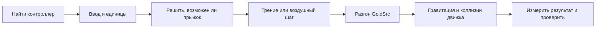

# HL1-Bhop-Everything — баннихоп / распрыжка GoldSrc

[English / Все языки](README.md) · [Русское пошаговое руководство](docs/START-HERE.md)

**Помоги любой доступной для моддинга 3D-игре обрести bhop — вместе с ИИ.**

Пошаговый набор инструкций, эталонная математика Half-Life 1 / GoldSrc и примеры для Unity, Unreal Engine, Godot и других движков. Можно использовать с Codex, Claude Code, Cursor или другим ассистентом, который умеет читать проект и менять файлы.

Это руководство по переносу движения, а не одна DLL для всех игр. Нужен доступ к контроллеру: исходники, API модов или исследуемая точка расширения. В закрытой игре результат зависит от её сборки и возможностей моддинга. В сетевой игре движение согласуют с серверной симуляцией.

Для инструментов со скиллами есть [SKILL.md](SKILL.md); для остальных достаточно стартового запроса и AGENTS.md.

## Начать за пять минут

1. Скачай этот репозиторий и распакуй в отдельную папку.
2. Открой папку в своём ИИ-инструменте.
3. Скопируй запрос ниже, подставь путь к своей игре или проекту и отправь.
4. ИИ определит движок, найдёт контроллер и выберет подходящую инструкцию. Если доступа к файлам или редактору нет, он объяснит конкретно, что нужно предоставить.

```text
Прочитай AGENTS.md и docs/START-HERE.md из этого репозитория.
Добавь bhop в игру/проект по пути: <МОЙ ПУТЬ>.
Нужны сохранение горизонтального импульса, стрейф GoldSrc и автопрыжок
при удержании назначенной кнопки. Сохрани обычную высоту прыжка и коллизии.
Сначала определи движок и найди единственный источник движения игрока.
Затем реализуй подходящий вариант, собери его и проведи проверки.
Не выдавай псевдокод за установленный мод и не называй непроведённые тесты успешными.
```

Если ИИ остановился на объяснениях, используй [поэтапные запросы](docs/AI-PROMPTS.md). Если ты впервые меняешь игру, начни с [пошагового руководства](docs/START-HERE.md).

## Выбери движок

| Движок / доступ | Инструкция | Что приложено |
| --- | --- | --- |
| Unity, исходный проект | [Unity](docs/UNITY.md) | Независимое C#-ядро, CharacterController-пример |
| Unity Mono / IL2CPP, готовая игра | [Закрытые игры](docs/COMPILED-GAMES.md) | Поиск точки расширения, ABI, восстановление |
| Unreal Engine | [Unreal](docs/UNREAL.md) | C++-ядро, локальный Pawn-пример, маршрут CMC и Blueprint |
| Godot 4 | [Godot](docs/GODOT.md) | Запускаемый 3D-проект, CharacterBody3D и тесты |
| Stride, O3DE, CryEngine, Source/idTech, свой движок | [Другие движки](docs/OTHER-ENGINES.md) | Контракт адаптера и точки поиска |
| Неизвестный движок | [Определение движка](docs/ENGINE-DETECTION.md) | Признаки, подтверждение версии, выбор пути |



## Что именно делает bhop

Скорость хранится между кадрами. В воздухе нет обычного наземного торможения. Стрейф добавляет импульс вдоль желаемого направления, ограничивая его проекцию. Прыжок в разрешённый кадр пропускает наземное трение. Это отличается от простого увеличения speed или air control.

Есть два профиля: `goldsrc-stock` со штатным срезом скорости распрыжки HL1 и `classic-bhop` без этого среза. Автопрыжок задаётся отдельно: он добавляется модом и не является исходным требованием HL1. [Формулы и единицы](docs/ALGORITHM.md), [настройки](config/presets.json).

## Проверки

Минимальный запуск без сторонних Python-пакетов:

```shell
python tools/check.py
```

Сравнение C++, C# и GDScript с одним набором контрольных данных описано в [TESTING.md](docs/TESTING.md). Установленный движок нужен для игровых испытаний. Точное состояние проверок этого выпуска записано в [VALIDATION.md](VALIDATION.md); наличие примера само по себе не означает проверку в редакторе каждого движка.

## Дополнительные задачи

- [Присед, потолок, короткий прыжок и урон от падения](docs/JUMP-CROUCH-FALL.md)
- [UPS-метр в стиле GoldSrc](docs/HUD.md)
- [Сетевая игра и предсказание](docs/NETWORKING.md)
- [Почему не работает: симптомы и действия](docs/TROUBLESHOOTING.md)
- [Добавить поддержку новой игры](CONTRIBUTING.md)
- [Английская точка входа](README.en.md)
- [Профиль игры](templates/game-profile.json), [шаблон отчёта](templates/implementation-report.md), [первичные источники](SOURCES.md)

В публикацию входят только собственные инструкции и примеры. Игровые DLL, приватные пути, чужие спрайты и готовые адреса конкретной сборки здесь не распространяются. Примеры и документация доступны по [MIT](LICENSE).
